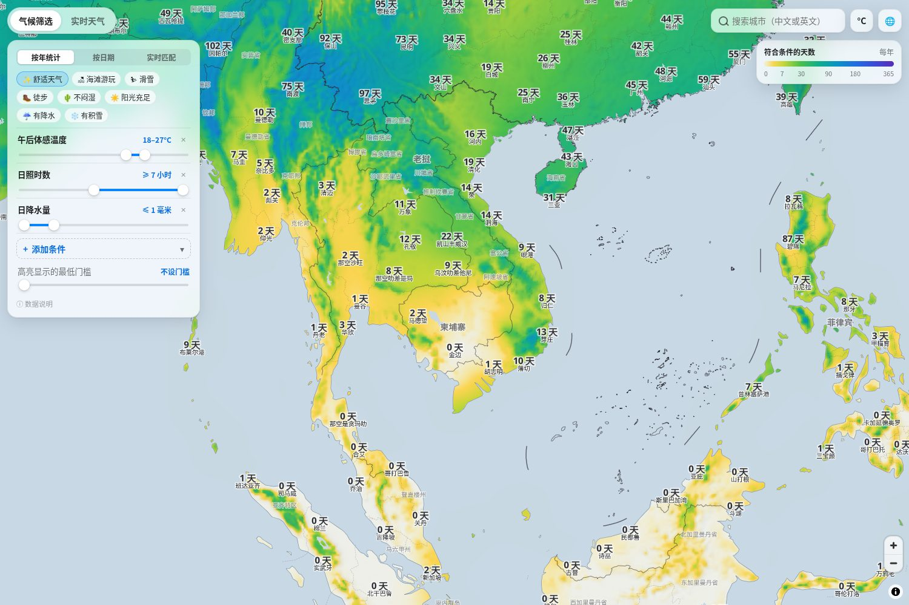
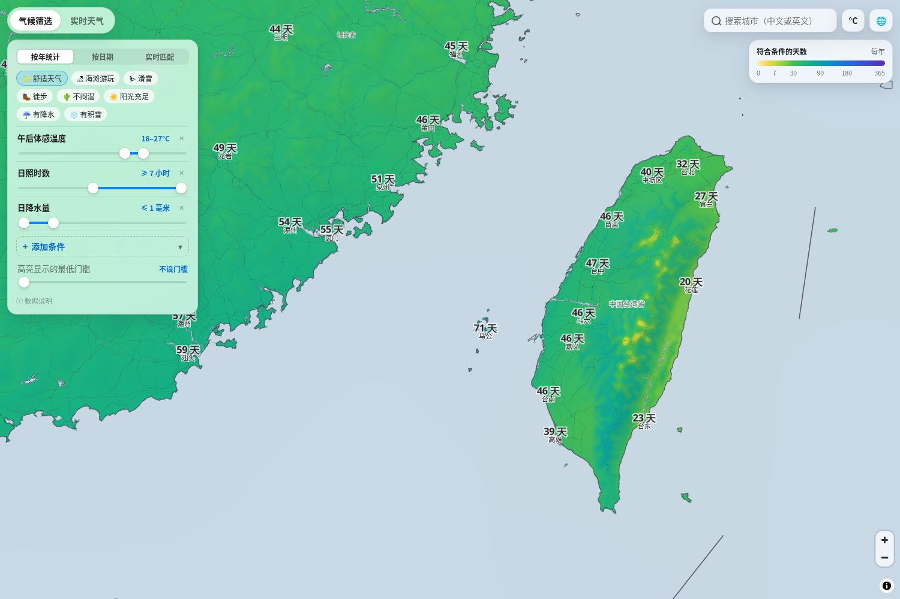
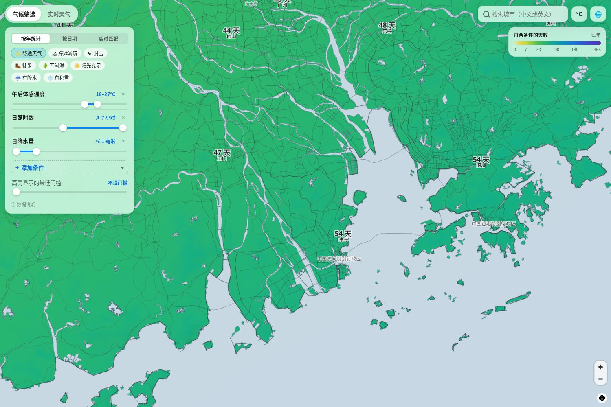

# 地图浏览器核验

核验版本：`3e82be73000f3637c097c7bf5d543d15d28283f2`。

[GitHub Actions 核验运行](https://github.com/xschen-beb/weather-atlas-zh-cn/actions/runs/38439497735)已成功完成。使用桌面 Chromium、1500 × 1000 视口和真实 WebGL 2 上下文，直接运行仓库的 `dist/`；未替换底图、地图数据或逆地理编码响应。9 项浏览器检查通过，页面错误和网络错误均为 0。

检查包括中国总览、南海断续线的实际渲染、台湾与香港澳门的中国归属标签、三个城市搜索结果及台北地点详情。地图中的国家标签图层没有将台湾、香港、澳门显示为独立国家。台北详情实测显示“台湾省，中国”。科学数据、中文功能与地图过滤规则的程序检查也通过。

截图复核后调整了地区标签的优先级，避免“中国台湾省”被城市天气标签挤掉。香港、澳门的完整地区标签在放大到合适级别后显示，避免在总览中互相重叠。下面三张截图来自上述最终核验运行，已人工查看。

## 南海

九个南海断续线段按保存的来源坐标显示；源数据中的台湾岛东侧线段亦保留。

## 台湾

## 香港与澳门

完整机器报告见 [report.json](report.json)，其余截图可在上述运行的 `map-browser-evidence` 附件中下载。地图来源元数据记录了初次导入阶段的状态；当前浏览器核验结果以本目录报告为准。此处核验范围为上述桌面 Chromium 场景。
